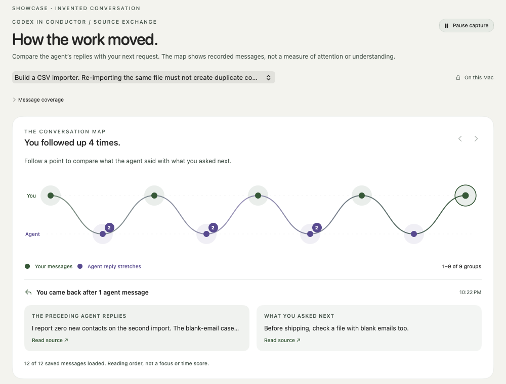

# Read a session, recover the thread

Start with a piece of work you want to understand: a feature, a bug or a decision. Choose its Codex conversation in Overview. A session can contain several tasks; the map does not automatically know where one feature ends and another begins.

## Start with what actually happened

The map has two lanes. Green points contain user-side directions; purple points contain agent reply stretches. Several consecutive agent messages can share a point, including progress updates. Selecting a point opens a comparison with the group before it. The substantive reply stays visible alongside a later progress update.

The sequence runs left to right in reading order. It is not a time, attention or strain chart. Missing source times make ordering approximate. The arrows expose earlier groups in the loaded window; Memory can search the older retained archive.

Counts describe the loaded messages from the selected session, capped at 500. “Times you came back” counts a user group after agent replies. It can include a correction, an additional requirement, a verification request or a simple continuation. It does not grade any of them.

## Read a concrete exchange

The public showcase invents a CSV-import feature. Its relevant sequence is:

1. The user asks for repeat imports without duplicate contacts.
2. The agent reports an implementation; the user reports duplicates again.
3. The agent reports another update and a successful build.
4. The user asks for the same file to be imported twice and for contact counts to be compared.

That comparison changes the question from “How many prompts did I write?” to “What did this reply settle, and what did my next request make more specific?” Here, a build result leaves the duplicate-import behavior unresolved. Asking for a reproducible acceptance check is useful direction.

The later reply reports zero new contacts on a second import but leaves blank emails unchecked. The next useful check is to repeat the blank-email case and compare the results. The provider's report, a directly inspected result and the user's own understanding remain different kinds of evidence.

## Treat the explanation as a hypothesis

An AI loop marker suggests that a requirement returned. Open its sources and compare the requests. The topic may instead have changed, or the agent may have been responding to a new constraint. A “steering” interpretation may identify a useful acceptance or scope boundary; it does not measure your capability.

The AI brief reviews a bounded excerpt, sometimes much smaller than the map. Its coverage is shown separately. A source reference can be accurate while the explanation is wrong. If a pattern does not fit, dismiss it. This hides that observation; it does not train the model or certify the rest of the session.

When no interpretation is supported, you can still inspect the actual exchanges. Lack of a marker does not establish smooth progress or successful review.

## Choose one check you can settle

Name the requirement in concrete terms, compare the expected and observed behavior, and record what remains uncertain. For the invented importer, that means using the same input twice and inspecting the contact counts, including the blank-email case. For another feature, the observable condition will differ.

Vernier supplies a review suggestion. It does not run that check for you, prove the agent's work correct or establish that you could recover the feature without assistance.

## Keep the scope in view

Today this is a view of saved Codex conversations from Conductor workspaces. It cannot establish what you read, checked or understood elsewhere. Short prompts and repeated questions can be appropriate. Daily fatigue, loss of ability, independent recoverability and the effects of Vernier's own interventions need evidence this release does not provide.

The current purpose is to help you reconstruct a concrete thread of work and choose a better next question. See the [research framework](RESEARCH.md) for the proposed work needed to make stronger claims.
