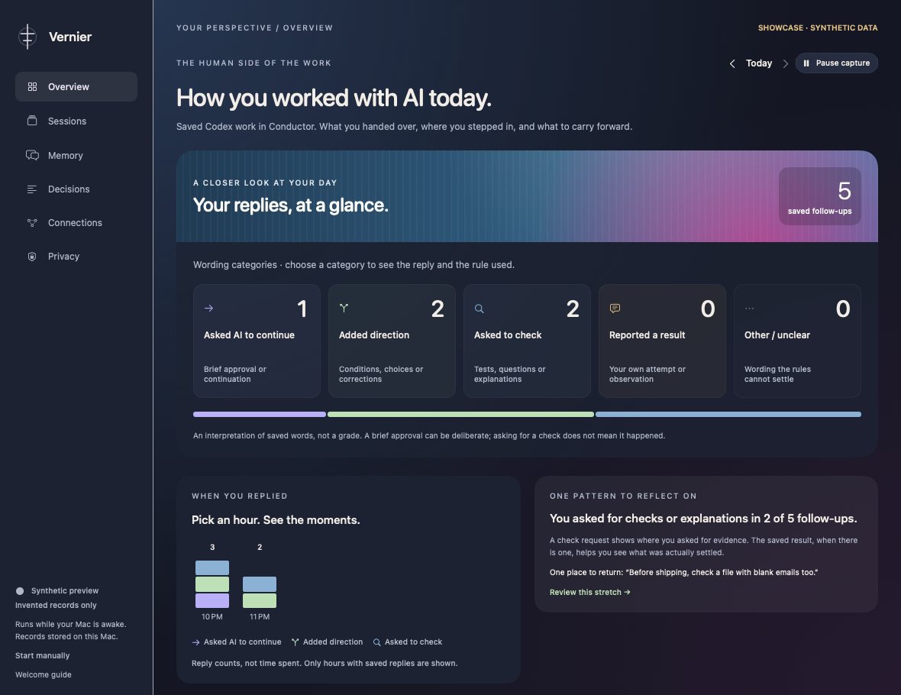
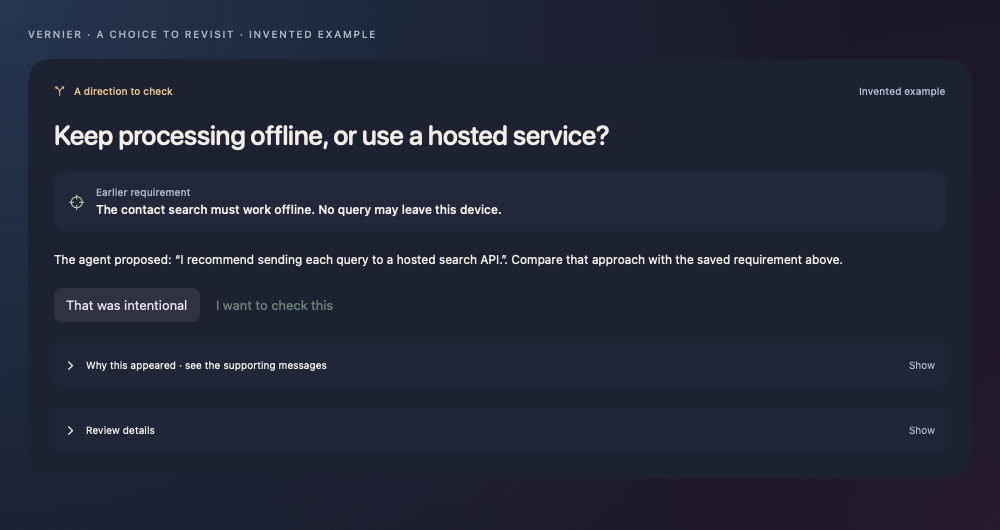
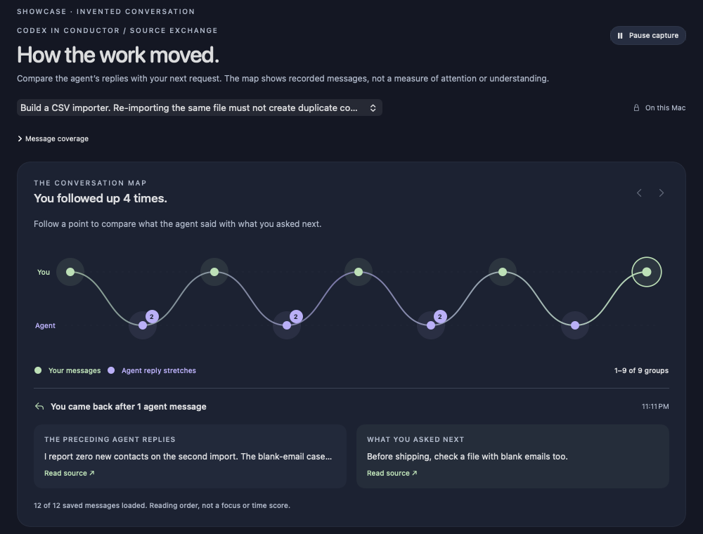

# Read a day, revisit a decision

Start with Overview. The default category cards describe saved follow-up wording; the chart shows when those replies were recorded. Choose a category or hour to see the exact messages and **Why this was counted**. A count is not a task percentage, an attention measure or a grade of thought. [Definitions and coverage](DAILY_RECAP.md).

The sources in every image here are invented. The native components are current; the conversation interpretations are hand-authored presentation fixtures, not model-evaluation results.

## Find a useful way back in

Below the visual overview, an available contextual reading connects a likely goal, the result reported so far and one specific checkpoint. For example, a successful build can leave an original interaction untested. The reading can suggest replaying that interaction without asserting that you failed to review it elsewhere.

Open **See why this reading was made** to inspect its exact saved interpretation. Supporting messages and review details stay available under their expandable headers. A model challenge and matching quotes do not establish semantic correctness; add your perspective when the account misses your situation.

The compact recap is another entry into the same saved work. Press **Control–Option–Command–V**, or reopen the app icon, then use its source action or the full-recap footer. If yesterday's fuller recap is shown, the action opens yesterday. Pause remains independent.

## Revisit a changed requirement

Some explicit conflicts can surface a question: keep the original requirement, or accept the proposed change? The card shows the earlier boundary and later proposal.

**That was intentional** records your choice. **I want to check this** records an open concern. These responses remain separate from the model's account and suppress repeat ambient nudges for the same pair. A quiet cue is a question about evidence, not a declaration that you were steered.

## Inspect the surrounding conversation

Open the saved exchange to compare your next request with the preceding agent response. Select a map point to inspect a source group; open its original record by ID.

The curve follows reading order, with separate speaker lanes. It does not encode time spent, attention or cognitive strain. The map loads at most 500 messages; coverage can be incomplete. A provider conversation can contain several tasks.

## Choose the level of interpretation

Local review is optional and initially off. In **Local model and review settings**, choose an installed engine and check its availability. Automatic revisiting has its own switch and waits for quiet saved work; it does not observe everything on the Mac.

The normal category cards remain wording-based. **Experimental model categories** is a separate, off-by-default mode that retains mixed acts and unread/withheld states. The tested configurations failed their quality gate. Source inspection and clear limitations remain necessary in either mode. [Reasoning](REASONING.md) · [Model results](MODEL_EVALUATION.md).

Your optional daily clarity/energy check-in records your own account. It is separate from the conversation, interpretation and any proposed future assessment of independent capability. The current source is Codex in Conductor; other personal agents are not connected yet.
