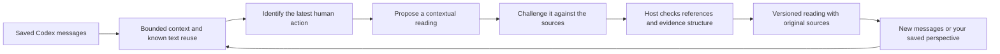

# Goals, checkpoints and direction questions — 0.11

The primary reader now connects surrounding messages to a likely practical goal and a concrete checkpoint. It no longer starts by labeling the latest message as a kind of human contribution. A vague request to investigate can be understood using the failure and agent diagnosis around it. Inferred goals and suggestions remain tentative.

The main card leads with the proposed check or a plain choice between approaches. Supporting excerpts and review details are collapsed. Goal-based conversation titles replace raw URL titles when a reading is available. The current conversation is kept across launches. The primary status explicitly distinguishes capture pause, manual review and automatic following.

## Two kinds of reading

**Literal boundary questions** handle five narrow, recognizable conflicts: offline processing versus hosted processing, no new dependency versus adding a package, preserving local data versus dropping its table, no paid service versus a paid API, and keeping data on-device versus uploading it. These questions use exact spans from a human requirement and an agent proposal, followed by a recognizable brief approval (at most twelve words). Sources must belong to the same conversation and appear in order. A substantive intervening human request suppresses an older boundary question. Negated proposed actions and known reused agent text are guarded. These are conservative text rules, not comprehension measurements or proof of a shared intended scope. They can miss differently worded constraints or misread scope.

A literal rule constructs only a question from its two source spans; it performs no inference call. The reading records the rule name and uses a separate local-rule engine label. It does not claim that an LLM challenge approved it. Other possible boundary conflicts use a dedicated local comparison and a separate model challenge, with the same source/role/approval guards. A short reply on its own never establishes a conflict.

**Contextual model readings** extract a likely goal, a specific next step, an outcome state and IDs of app-made witness spans. The app supplies the exact saved text for those IDs; the model never has to reproduce a quotation. The app composes restrained text attributing a proposal or report to its actual speaker; a second model pass checks the goal, account and checkpoint. Build-only or explicitly unrun checks are guarded rather than treated as demonstrated behavioral success. Explicit topic switches separate a new question from unrelated older reports. This is still imperfect: a valid quote does not establish a correct relationship or a useful recommendation. Unsupported readings are withheld.

The model does not write an unrestricted biography or a cognitive score. Goal and next-step text are bounded and screened for recognizable unsupported personal verdicts. Exact witness spans must occur in both the supplied excerpt and saved original. Witness and source IDs are constrained and rechecked. Even a one-word disagreement remains eligible evidence. The model cannot call tools or control a coding agent. Ollama requests serialize their schema deterministically; schema validity is not semantic validation.

## Quiet cues and your response

A current direction question can mark the circle in amber and add a branch indicator to the menu-bar icon, without opening a window, animating continuously or interrupting another app. Its explicit dashboard arrow opens the relevant conversation. Quick view prioritizes that question. A cue expires after an hour and is suppressed while capture is paused, during system rest, after source changes, or after a matching response.

**That was intentional** and **I want to check this** save separate human reports. The response is linked to the original reading and a stable fingerprint of the requirement/proposal pair, so later short approvals of that same pair do not keep nudging. A different proposal or edited source gets a different key. An intentionally accepted literal change is passed back to contextual review rather than repeatedly regenerating the same rule question. Reports are self-reports, not proof of review or understanding. Source invalidation and erasure also remove dependent reports; they are not permanent independent notes.

## Scheduling and accumulated context

Collection retains its adaptive 20/60/180-second cadence. Automatic reviews are serial, at most once per two minutes, with at least fifteen seconds of source quiet and a two-minute per-conversation retry interval. Changed conversations active in the last day rotate by oldest reading, giving unreviewed work a chance. A large backlog can take substantially longer to cover. Automatic inference rests in Low Power Mode; manual review remains available. There is no claim of instantaneous interpretation of every running agent.

The previous goal, reading and cited sources help provide continuity on later short requests. Goal-source references are canonical message IDs, not transient prompt labels. A prior goal can also help retrieve candidate related context when the next request is short. Retrieved context is explicitly unconfirmed. This is bounded external memory, not model-weight training, the Google Sleep algorithm, a complete task graph or a personal cognitive model.

The original context limits and storage protections below remain in force: canonical records stay separate, source changes invalidate dependents, stale/revoked results cannot commit, and erasure/export include derived readings. Schema stays v5; older revision payloads still decode. See [current model tests and limitations](MODEL_EVALUATION.md), [UI walkthrough](READING_A_SESSION.md) and [privacy](PRIVACY.md).

---

# Historical implementation: action readings — 0.10

# A reading that changes when the evidence changes

Vernier 0.10 adds an experimental local reasoning loop to the main dashboard and compact view. Its job is to reconstruct a particular exchange: what you wanted, what the agent proposed, what your next message contributed, and which question the record leaves open. It does not determine whether you are losing cognitive ability or being controlled by an agent.

A person can delegate execution while selecting the method, setting a boundary or asking for evidence. Those actions can coexist. A short approval may be an informed decision or a deferred review; the words alone do not settle that. Asking for an explanation is observable. Understanding the explanation is a different claim.

## What actually runs

`DecisionContext` keeps the latest user contribution as its anchor, rather than interpreting an agent progress reply as the person's decision. It reads up to 60 recent canonical messages, the three latest human messages, the messages just before the true latest human contribution, opening requests and previously cited evidence. A long stretch of agent progress replies must not replace the latest human anchor with an old opening prompt. A bounded search can find earlier known agent text copied into the current supplied message. Eight-word normalized matches mark known reuse. Added words around a quotation are kept separately; remaining words are not guaranteed original human authorship.

The model packet starts with up to 12 recent messages and preserves the latest human contributions, their preceding proposal, the opening request and earlier cited evidence, capped at 18 messages from the current conversation. It can add up to four retrieved messages from other conversations. Duplicate inputs are removed before assigning source labels. Saved text remains unchanged. Prompt excerpts are clipped to 1,400 characters for user messages, 650 for agent replies and 1,200 for added text in mixed messages. Attribution itself examines up to 8,192 visible characters per selected source. These limits can hide important context. Conversation content must already have been enabled; this does not capture private model reasoning, browser activity, clicks or reading behavior.

Related retrieval searches at most 60 prior readings in the **same workspace**, ranks overlap in concrete goal words, and includes at most two candidate conversations. This is an index for finding possible context, not a declaration of a shared task. Sources from another conversation have an explicit scope label in the prompt and UI. Projects in different workspaces are not linked. There is no canonical task graph or daily personal baseline yet.

A focused first pass extracts observable acts as yes/no claims: asking for a test, asking for an explanation, choosing a constraint, reporting a result, accepting a new proposal or delegating execution. A deterministic precedence combines those potentially overlapping acts into a tentative primary action. Delegating execution does not erase a choice or request for evidence. The next model pass selects source IDs for that action; it does not write the displayed account. If the selected sources include the real anchor, the host can add the actual neighboring agent reply and, for a recurring-issue proposal, a preceding human report. This supplies context for the critic, not proof that the proposed relationship is correct. The host composes restrained language from the proposed action and overlapping acts, copies the saved request as the goal, and retains literal source excerpts. The critic sees the same evidence and proposal. All three passes use one local model with no tools; agreement is not independent confirmation. The host checks real references, inclusion of the current anchor, distinct user evidence for repeated issues, known copied text and recognizable unsupported personal claims. Those checks prevent some structural failures; they cannot establish semantic truth or catch every misleading sentence. A failed check produces an uncertain reading rather than a confident verdict. A malformed, truncated or oversized-context response is not persisted.

## Revisiting and correction

Automatic reviews require the separate “Revisit changed work automatically” choice, off initially even when local analysis was already enabled. They cover changed conversations active within the last day, with at least two saved messages. They run serially, at most once per five minutes, with a five-minute per-conversation retry interval. They wait for at least 45 seconds of source quiet and rest automatically in Low Power Mode; explicit manual review remains available. Conversations without a reading are considered before already reviewed ones; among reviewed conversations the oldest review goes first. There is no fixed-time daemon independent of the running app. Sleep, inactivity, user Pause and source/content/analysis revocation stop scheduling and invalidate pending writes.

An unchanged evidence digest and engine/prompt version reuse the prior reading. Content writes also mark affected conversations and their known retrieval dependents for reconsideration, including edits that do not change a message count. New source counts, human perspectives and changes in previously retrieved conversations make a reading eligible again. Editing an input source invalidates its dependent readings. Perspectives attached to a deleted reading also cascade away; they are not an independent permanent notes archive. Manual Revisit bypasses the scheduling interval, while still honoring consent and unchanged-evidence reuse. Stop review cancels the current review without pausing capture. Cancellation may not immediately stop the underlying model's computation.

Each saved revision retains its predecessor ID, evidence, source fingerprints, coverage, engine and time. Up to 40 revisions per conversation are retained, plus revisions with an attached human perspective. History shows what the interpretation said earlier. Adding your perspective is a separate user report; it can change the next reading without rewriting the original conversation or proving comprehension. A perspective is limited to 1,500 characters and references the specific revision and anchor it concerns. An open draft keeps that target if selection or background history changes; the editor names its saved request. Erasure clears the draft. An old correction cannot silently become an explanation of a different request.

The SQLite write transaction rechecks source fingerprints, the actual latest canonical-message frontier (including app context excluded from the prompt), related conversation counts and human reports. A result based on stale or revoked evidence cannot commit. Schema v5 preserves metadata, notes and canonical conversations from v4 and adds revisions, perspectives and source dependencies. Retention, erasure and private JSON export cover derived readings too. Erasing a cited source also invalidates dependent readings in another conversation.

## What to expect in the interface

The dashboard presents a working interpretation, exact excerpts, another possible reading and the unresolved fact. Source links retrieve the exact canonical message by ID in Memory, without ambiguous text search; the surrounding-exchange action focuses the anchor in the conversation map. History can show an earlier account and return to the latest one. Your own perspective stays visibly separate. The map now leads with the recorded exchange; older template/brief interpretations no longer compete with the main account.

The menu-bar view is a compact entry into the same selected reading. It retains fixed outer geometry and independent Pause, dashboard, Memory and Quit controls. The floating circle remains a capture control, not a review or comprehension badge. No new macOS observation permission is introduced.

See [local model evaluation](MODEL_EVALUATION.md), [privacy](PRIVACY.md) and [validation](VALIDATION.md). Synthetic showcase readings are hand-written presentation examples, passed through source validation; they are not model-accuracy demonstrations.
