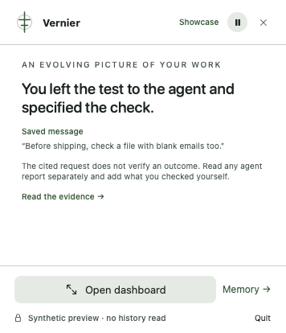
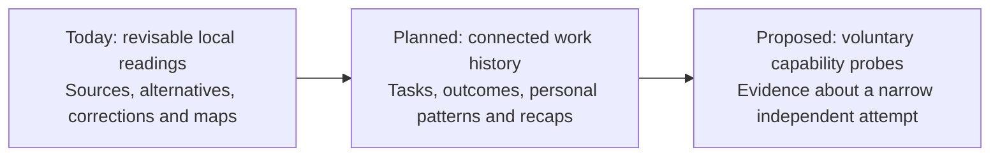

# Vernier

**Understand how you steer AI-assisted work.**

[](https://github.com/romrom-20/Vernier/actions/workflows/ci.yml)
[](LICENSE)


A coding session can produce a working feature and a long conversation. Reconstructing how you got there is harder: which requirement kept returning, where you changed direction, what evidence the agent offered, and what still needs checking.

Vernier is being built as a **personal instrument for understanding and directing your work with AI over time**. The intended experience connects your goals, delegation, questions, corrections and available outcomes, helping you notice a pattern and find a useful way back into the work.

Today, the experimental Mac app gathers consented **Codex history from Conductor workspaces** and starts with your part in an exchange: what the agent said, what you added or questioned, and why that contribution may matter. Each reading opens its original conversation. Interactive maps open the surrounding exchange. An optional local model revisits a source-backed account as new evidence and your corrections arrive; bounded same-workspace retrieval can supply possible related context. Connected task histories and personal recaps remain planned.

The broader question is **human agency in AI-mediated work**: when does delegation expand what you can do, and what remains within your ability to understand, redirect and recover?

**Current version: 0.10.0.** An experimental local reasoning loop extracts proposed observable acts from the latest human request, selects sources, composes an account and challenges it in a separate pass, checks its source references, and saves a revisable history. The dashboard separates the reading, literal evidence, another possible explanation and what remains unknown. You can add your own perspective. Neither model agreement nor a valid citation proves the account is correct. There is no comprehension, cognitive-effort or agency score. [How the loop works](Docs/REASONING.md).


*Offscreen render of the actual native SwiftUI view in isolated showcase mode. The conversation is invented. The hand-written example shows an agent report and a request for a missing check; no model ran. It demonstrates layout and sources, not understanding, correctness or measured AI accuracy.*



*Offscreen render of the exact menu-bar content using the same invented records. Its normal popover geometry and routing are tested separately.*

## The product we are working toward

A useful personal recap would help you understand:

- **How the work developed:** what you wanted, what you delegated, which decisions you revisited, and what the available evidence says happened across sessions.
- **How your interaction changed:** stretches of simple continuation, recurring repair requests, new constraints and verification questions, interpreted in the context of the task and your own history.
- **How to regain direction:** an explanation of a consequential unresolved question and one small check that could settle it. More questions can be good oversight; efficient delegation can be good judgment.
- **What you could recover independently:** later, voluntary sandbox exercises could test whether you can explain, modify or take over a narrow piece of work without the original agent.

The aim is to recognize useful patterns and support better decisions. A long agent run does not establish that you stopped paying attention; repeated questions do not establish excessive checking or fatigue. Those explanations need context and, for capability claims, evidence beyond conversation logs.



*Product direction. The later stages are not demonstrated by the current screenshots. Broader source adapters and context-aware guidance need their own implementation and evaluation; causal claims additionally require the longitudinal experiments described in the research framework.*

## A concrete example

Imagine building a CSV importer:

1. You specify that importing the same file twice must not create duplicate contacts.
2. The agent reports an implementation. You try again and report duplicates.
3. After another update and a successful build, you ask for the same file to be imported twice, with before-and-after counts.

The useful story is the relationship between those events. A requirement returned after a completion claim. You made the acceptance check more specific. The blank-email case still needs evidence.

Vernier helps reconstruct that sequence. A possible repair loop links back to its messages; selecting a point compares the preceding agent reply with your next instruction. Repeated questions can represent careful oversight. Their number alone cannot tell us whether the delegation was appropriate or what you understood.


*These are offscreen renders of the app’s real SwiftUI components using invented records, with no personal archive or live model. The same invented session. Green points identify user-side directions; purple points identify agent reply stretches. The curve follows reading order.*

## How to read it

- **The working account:** the local loop describes a concrete human contribution and its surrounding exchange. Read the exact sources, compare the alternative and missing fact, and add your perspective if it misses something. [Method and limits](Docs/REASONING.md).
- **The record:** the map shows saved messages from one session. Select a point, compare neighboring exchanges, and open the exact source. Its window is capped at the latest 500 saved messages; coverage stays visible.
- **The history:** a later message or correction can change the account. Earlier readings remain inspectable. A valid reference or agreement between model passes still does not establish truth.
- **The unresolved check:** a named missing result can help you re-enter the work. A request for a test is distinct from a passing result, and an agent’s success claim is distinct from independent verification.

The diagram's height identifies the speaker. It does not encode attention, elapsed time or cognitive strain. A provider session can contain several features; it is not automatically one human task.

[Walk through a session](Docs/READING_A_SESSION.md) · [Map semantics and design rationale](Docs/VISUAL_REVIEW.md)

## What works today

- **Revisable local readings:** a focused action reading, source selection, host-composed account, challenge and source checks. Literal evidence, alternatives, unknowns, history and your corrections stay separate. Optional local inference uses already-consented saved content.
- **Visual review:** interactive speaker lanes, before-and-after comparisons and source navigation. Counts are folded into coverage; old interpretation panels no longer compete with the main account.
- **Quiet Mac presence:** native SwiftUI/AppKit, menu-bar quick view, optional draggable circle/pill and short, reduced-motion-aware transitions. Pause works in place; Open dashboard opens Studio. The circle controls background memory; collection continues while it is hidden.
- **Codex in Conductor:** read-only local history access. Vernier never starts, resumes or controls an agent.
- **Local memory:** available prompts, visible replies, allowlisted agent activity metadata, your notes, archive search and export. Coverage and missing history stay visible.
- **Separate choices:** metadata, conversation capture and local AI interpretation are distinct opt-ins, off on a fresh install.
- **User-owned storage:** SQLite, incremental backfill, retention, conversation erasure and full local deletion. Optional login registration and adaptive sync support resident use; Quit is respected.

## Try the synthetic showcase

Requires a Mac, Swift 6+, and Apple Command Line Tools or Xcode. macOS 14 is the deployment target; cross-version compatibility is still being tested.

```sh
git clone https://github.com/romrom-20/Vernier.git
cd Vernier
./Scripts/showcase.sh
```

The showcase uses invented, in-memory records and separate preferences. It opens no personal archive, starts no connector or model, and cannot register a login item. Open a reading, compare its sources, explore map points, and try the pill's hover, drag and pause controls. Quit from the menu bar when finished.

## Install on your Mac

```sh
# Quit any running copy before updating.
./Scripts/install-local.sh
open "$HOME/Applications/Vernier.app"
```

This installs a local development app at `~/Applications/Vernier.app` and preserves the previous same-ID bundle. Enable sources in Connections, conversation capture in Memory, and optional login/pill behavior in Privacy. Closing Studio leaves the menu-bar app running.

**Local reasoning is experimental, optional and off for new installations.** It runs through a separately installed [Ollama](https://ollama.com/) model on your Mac, or the experimental Apple on-device alternative on an eligible macOS 26.4+ installation. Open Overview → local reasoning, choose an installed model and use **Check local engine**. No Vernier backend, extra ChatGPT plan or paid model API is required. Automatic revisiting has its own switch, initially off. Start with a manual reading and compare its sources: none of the tested configurations met the interpretation-quality gate. Apple’s eligible on-device model needs no separate weights or API subscription; Ollama is an optional local alternative. The reader and map work with inference off. See [model setup, test results and limits](Docs/MODEL_EVALUATION.md).

A live connector requires Conductor's installed Codex binary and available local history. This is a source release with an ad-hoc signature; a notarized download, DMG and automatic updater are not available.

## Privacy and scope

Personal records stay in a private Application Support directory on your Mac. The SQLite database is not encrypted. Credential redaction is best effort; conversations and exports can still contain sensitive material. No captured conversation is sent to a cloud model by Vernier.

Only Codex history under `~/conductor/workspaces/<repository>/<workspace>` is currently connected. Claude Code, Cursor, ordinary ChatGPT chats, Perplexity and other agents are not connected. Vernier does not collect global mouse movements, screens, keystrokes, browser tabs or reading behavior.

Default retention is 30 days by session update time. Pause suspends synchronization; resuming can import provider history created while paused. Turning capture or analysis off retains existing records until erased or removed by retention. Memory erasure also clears derived readings, saved perspectives, legacy briefs and the in-memory overview and map.

**This repository contains source, tests, documentation and reviewed synthetic images. Personal conversations, databases, exports, local settings and workspace attachments are excluded.** Publication checks reject private artifact paths and unreviewed or changed image bytes; human review remains necessary.

[Privacy details](Docs/PRIVACY.md) · [Connector coverage](Docs/CONNECTOR_COVERAGE.md) · [Publication boundary and audit](Docs/PUBLICATION.md)

## The research direction

The ambition is an instrument for understanding human agency, with three separate evidence layers: **passive observations today, separately consented capability probes proposed, and longitudinal experiments proposed**. The framework keeps prior independent ability, AI-assisted performance, later unaided ability and Vernier's own effects separate.

The critical test is whether richer interaction history predicts independent understanding or recoverability better than task difficulty, prior skill and simple usage counts. A useful recovery tool would still be valuable if that measurement hypothesis fails. No comprehension, fatigue, attention, intelligence, cognitive-decline, agency or readiness score is claimed today.

[Product thesis](Docs/PRODUCT.md) · [Measurement framework](Docs/RESEARCH.md) · [Roadmap](Docs/ROADMAP.md) · [Architecture](Docs/ARCHITECTURE.md)

## Verify and contribute

```sh
./Scripts/verify.sh       # Core checks, bundle build, plists and signature
./Scripts/verify.sh --ui  # Adds isolated native checks; interactive Mac required
python3 Scripts/test-public-content.py
python3 Scripts/check-public-content.py
```

GitHub Actions runs the shared core checks, XCTest, bundle build and publication checks on macOS. The isolated `--model-smoke-test` checks application state and source routes without a graphical activation requirement. Native regressions exercise hover, pause, window routing, source navigation and projection lifecycle. These checks do not establish physical mouse, hardware sleep/wake or cognitive-measurement validity.

[Executed validation and remaining gaps](Docs/VALIDATION.md) · [Interaction checklist](Docs/INTERACTIONS.md) · [Contributing](CONTRIBUTING.md) · [Report a bug](https://github.com/romrom-20/Vernier/issues/new/choose) · [Security reporting](SECURITY.md)

Built by [romrom-20](https://github.com/romrom-20), with AI coding assistance. [MIT licensed](LICENSE). Vernier is a working project name and an early experiment.
