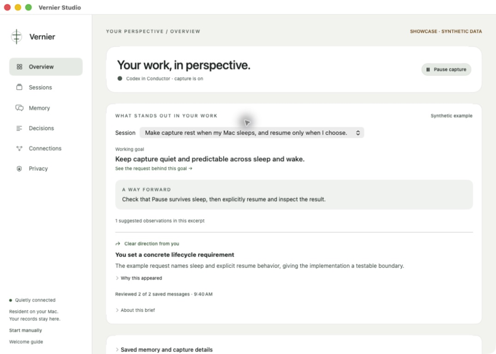

# Vernier

**An instrument for understanding human agency in AI-mediated work.**

[](https://github.com/romrom-20/Vernier/actions/workflows/ci.yml)
[](LICENSE)


Vernier asks a question that becomes more important as agents do more of our work:

> When does delegation expand a person’s effective capabilities, and when does it leave them less able to understand, redirect or recover the work?

The project brings together a quiet, native Mac utility, a local record of human–AI interaction, and a research direction for measuring independent capability. It aims to help people understand what they delegated, what AI enabled, and what remains within their own ability to explain, change and recover.

**The current app implements part of the observation foundation:** consented Codex history, searchable local memory, user-authored review, and optional on-device AI session briefs. A brief suggests the working goal, source-linked interaction patterns and a concrete next step; it is an interpretation of an excerpt. Capability probes, longitudinal experiments and validated agency assessments are not implemented.



*Actual native app, using the isolated showcase mode. Every session, message and count in this image is synthetic.*

## The measurement framework

Vernier separates three layers with different kinds of evidence:

1. **Passive interaction signals:** records of delegation, revision and other supported actions can describe what happened. They cannot establish understanding. Today’s connector provides only a subset: recorded Codex conversations, safe agent activity metadata and personal notes; it does not observe human inspection or approval across the Mac.
2. **Active probes — proposed:** occasional, separately consented sandbox tasks could test whether a person can predict, explain, verify, challenge or independently perform a narrow task. A successful attempt would not establish a permanent change in capability.
3. **Longitudinal experiments — proposed:** controlled studies could test whether patterns of AI use or Vernier’s own interventions affect later independent performance. A causal claim would require an appropriate design; it would not establish universal cognitive decline.

The framework keeps four questions separate: **what a person could do before, what AI enabled during the task, what they could do afterward without AI, and what Vernier itself changed.**

Prompt wording can change the interaction we observe without changing underlying ability. Asking for an explanation may elicit more verification language; it does not by itself establish better judgment. A reminder may improve the AI’s answer rather than the person’s reasoning. Both possibilities matter to the design.

## Independent recoverability

If AI became unavailable, could you identify a failing subsystem, explain the tradeoffs, modify the implementation, recover the project from its artifacts, or hand it to someone else?

That is a promising direction to validate through narrow, voluntary sandbox exercises. Vernier would not need to interrupt real AI access. Good delegation can include accepting sound advice as well as rejecting bad advice; indiscriminate refusal is not the goal.

## The critical experiment

**Does interaction history predict independent understanding or recoverability better than a baseline using task difficulty, prior skill and AI-usage counts?**

If richer signals add no useful predictive value, that challenges the measurement thesis. A useful project-recovery and oversight utility would still be a worthwhile outcome. If prediction improves, the next question is whether targeted interventions cause better independent performance.

[Product thesis](Docs/PRODUCT.md) · [Measurement framework and proposed experiments](Docs/RESEARCH.md) · [Roadmap](Docs/ROADMAP.md) · [Architecture](Docs/ARCHITECTURE.md)

## What works today

- **Native presence:** SwiftUI inside AppKit, a bounded menu-bar quick view, and an optional draggable, nonactivating pill.
- **Direct capture controls:** a quiet circle expands on hover or click; play/pause changes capture in place; only the dashboard arrow opens Studio. Quick view and Studio replace one another instead of stacking.
- **Codex in Conductor:** read-only local history access, scoped to Conductor workspaces. No agent is started, resumed or controlled.
- **Separate permissions:** session metadata and conversation text are distinct opt-ins, both off for new installations.
- **Local conversation memory:** available prompts, visible assistant replies, and allowlisted agent activity metadata. Search and export include the retained archive; incomplete histories stay labeled.
- **User-owned storage:** SQLite, incremental backfill, retention, export, conversation erasure and full local deletion.
- **Local AI session briefs:** Apple’s on-device model suggests a working goal, possible handoff stretches, recurring repair, clear steering and explicit alternatives. Inspect the actual source messages, dismiss an interpretation that does not fit, and use a small next step to settle the task. Coverage is shown; observations are not measurements of capability.
- **Interaction review:** readable session labels, a bounded prompt trail, and your own account of intent, steering, understanding and checked evidence.
- **Resident lifecycle:** optional native login registration, adaptive sync cadence, rest during sleep/inactive sessions, and preserved Pause across wake.

## What it cannot tell you

Vernier does not measure comprehension, fatigue, attention, intelligence, or cognitive decline. It has no strain/readiness score. Short continuation wording is only a literal text flag.

It does not record global mouse movements, screens, keystrokes, browser tabs or reading behavior. **The pill's mouse interactions are tested; your other mouse activity is not collected.** Even opening a diff would not prove that you understood it.

Only Codex history under `~/conductor/workspaces/<repository>/<workspace>` is currently supported. Claude Code, Cursor, ordinary ChatGPT chats, Perplexity and other agents are not connected. A provider's “completed” response is not proof of correctness, review or shipping.

## Try it without connecting anything

Requires a Mac, Swift 6+, and Apple Command Line Tools or Xcode. macOS 14 is the deployment target; cross-version compatibility is still being tested.

```sh
git clone https://github.com/romrom-20/Vernier.git
cd Vernier
./Scripts/showcase.sh
```

Showcase uses labeled, in-memory synthetic sessions and a separate preferences domain. It opens no personal archive, starts no connector, and cannot register a login item. Try hover, drag, play/pause and the native context menu. Quit from the menu bar when finished.

## Build and install locally

```sh
# Quit any running copy before updating.
./Scripts/install-local.sh
open "$HOME/Applications/Vernier.app"
```

The installer creates `~/Applications/Vernier.app` and preserves previous local app bundles. Closing Studio leaves the menu-bar app running. Enable sources in Connections, text capture separately in Memory, and optional login/pill behavior in Privacy. Quit is always available.

This is a source release with an ad-hoc local build. A notarized download, DMG and automatic updater are not available yet. No Vernier cloud account, backend or separate API key is required. Optional AI briefs run on this Mac using Apple Intelligence; they require macOS 26.4+, an eligible Mac with the model ready, and a build with the Foundation Models SDK. The history reader works without local AI. Enable briefs from Overview or Privacy; they are off for new installations. A live connector requires Conductor's installed Codex binary and available local history.

## Privacy and data boundaries

The app stores records at `~/Library/Application Support/local.vernier.instrument.dev/sessions.sqlite` with private directory/file permissions; it does not encrypt the database. Metadata uses salted identifiers. Conversation capture excludes private reasoning, attachments and raw tool/file output; credential redaction is best effort and private details may remain.

Default retention is 30 days by session update time. Pause suspends synchronization; resuming can import provider history created while paused. Turning text capture or local analysis off keeps the existing archive and briefs until erased or removed by retention. Erase conversation memory clears derived briefs too. No captured conversation is sent to a cloud model. Exported conversations are sensitive.

[Privacy details](Docs/PRIVACY.md) · [Connector coverage and bounds](Docs/CONNECTOR_COVERAGE.md)

## Verify the implementation

```sh
./Scripts/verify.sh       # Core checks, bundle build, plists and signature
./Scripts/verify.sh --ui  # Adds isolated native checks; needs an interactive Mac session
```

The shared checks also run through `swift test` with full Xcode. GitHub Actions runs core checks, XCTest and the bundle build on macOS; it does not claim physical mouse or sleep/wake testing.

Native regressions cover stationary hover during resizing, canceled exit on re-entry, direct play/pause without opening Studio, nonactivation, bounded popover placement and pause preservation. Storage/protocol checks cover deduplication, migration, consent revocation, redaction, search, export, retention and read-only requests.

[Interaction specification and manual mouse checklist](Docs/INTERACTIONS.md) · [Executed validation and remaining gaps](Docs/VALIDATION.md)

## Contribute

Useful contributions include native interaction testing, source adapters, privacy/accessibility work, and research designs that distinguish visible behavior, assisted performance and independent capability. Use synthetic reproductions in public issues.

[Contributing](CONTRIBUTING.md) · [Report a bug](https://github.com/romrom-20/Vernier/issues/new/choose) · [Security reporting](SECURITY.md)

Built by [romrom-20](https://github.com/romrom-20), with AI coding assistance. [MIT licensed](LICENSE). Vernier is a working project name and an early experiment.
