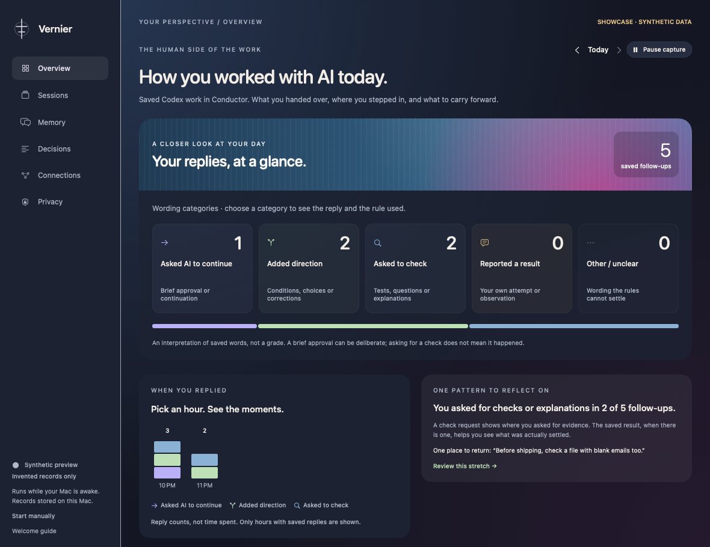
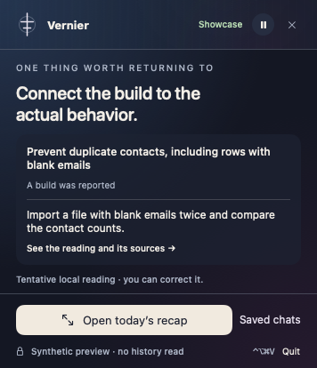
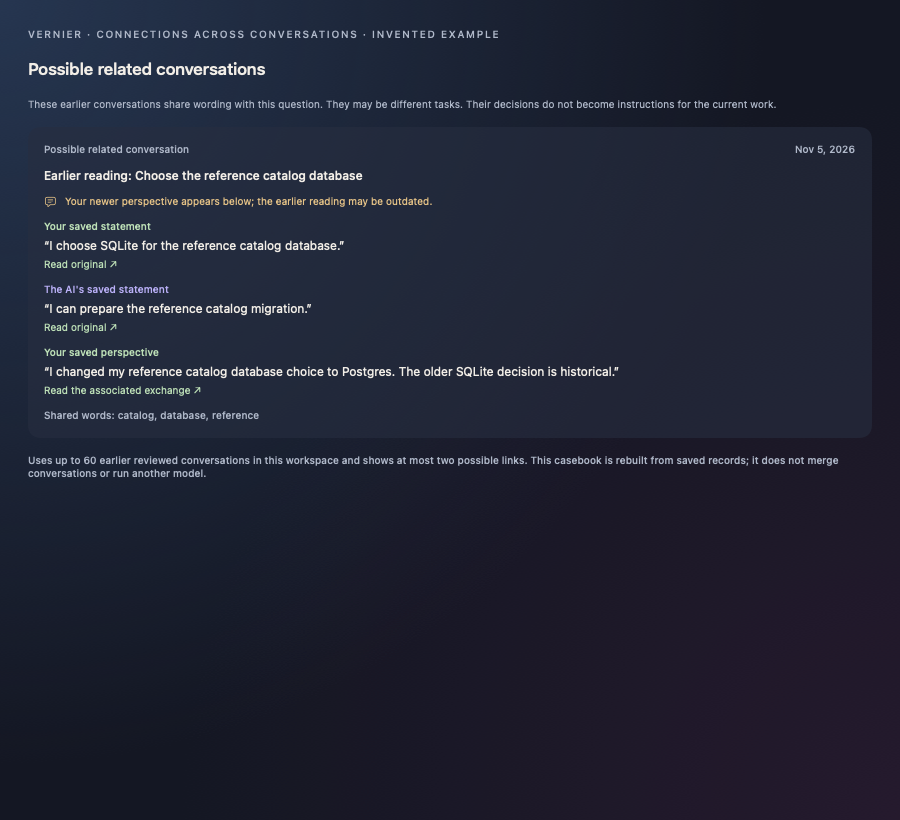
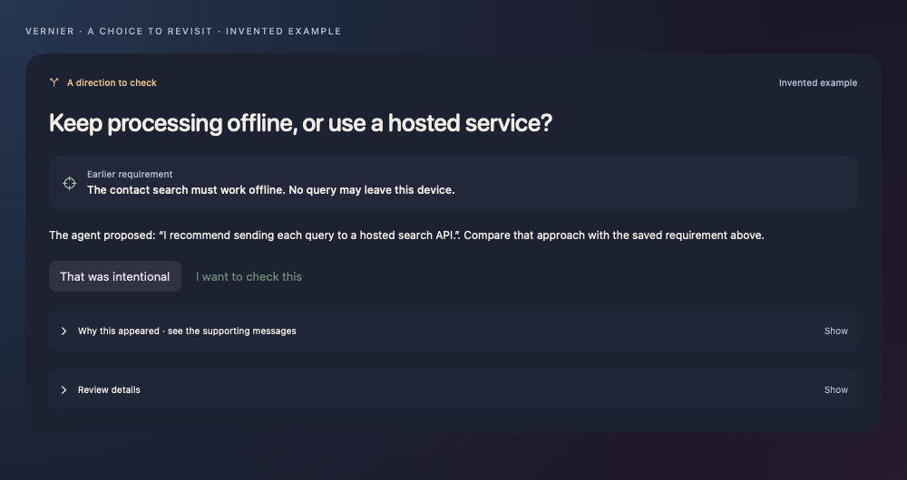
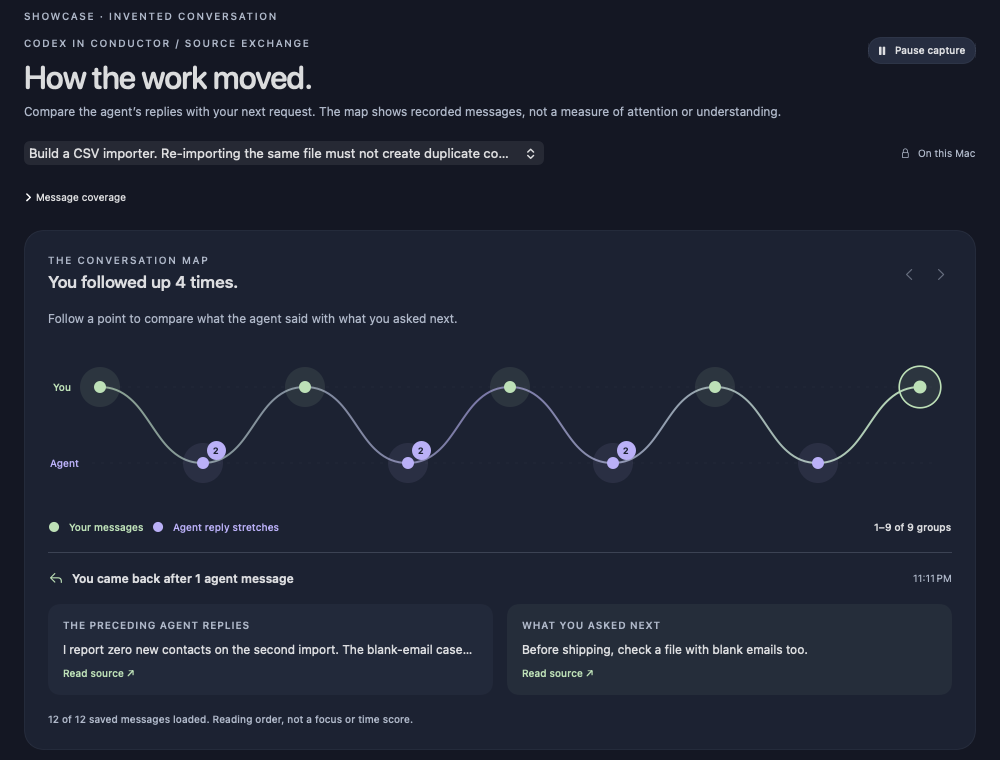
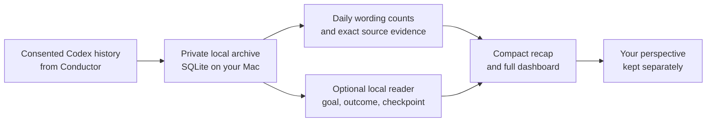

# Vernier

**Keep your judgment in view as you use AI.**

[](https://github.com/romrom-20/Vernier/actions/workflows/ci.yml)
[](LICENSE)


AI can help you build, research, plan and decide. It is harder to see **how those interactions are changing your choices**: what you meant to do, what the AI introduced, what you accepted deliberately, and what you later wished you had questioned.

Vernier is an open-source Mac app exploring that human side of AI. It keeps a local record and gives you a quiet way to revisit the interaction, with the original evidence close by. **Codex in Conductor is the first connected source.** Personal agents and everyday decisions are part of the wider direction.

[Try the showcase](#try-it) · [Product direction](Docs/PRODUCT.md) · [Model and memory status](Docs/MODEL_STATUS.md) · [Evaluation results](Docs/MODEL_EVALUATION.md)



*Current 0.14 UI, rendered offscreen from invented records. The default cards use wording rules. Showcase conversation readings are hand-authored and source-checked; these images demonstrate the interface, not model accuracy.*

## The question behind Vernier

**Am I choosing a direction with AI, or being carried toward a choice I did not intend?**

That question reaches beyond coding. A personal agent might change a plan, a research assistant might narrow the options you consider, or a coding agent might introduce an approach that conflicts with your original requirement.

A useful instrument should help you notice that change, understand its context, and decide whether it was intentional. Accepting a suggestion can be good judgment. So can delegating an entire task. A short approval alone cannot tell us which happened.

Vernier does not yet answer that question reliably across your life. The current app builds the foundation: consented history, inspectable observations, revisable local readings and your own perspective. [The full thesis and current limits →](Docs/PRODUCT.md)

## What you can use today

**A visual picture of the day.** Category cards and an hourly chart show recorded follow-ups, with exact-message drill-down and an explanation of how each was counted. Optional clarity and energy check-ins record how the work felt to you.

**A recap across conversations.** The compact panel summarizes saved follow-ups across the day, with conversation checkpoints available underneath. Local readings connect a likely goal, the available outcome evidence and a next check. A proposed fix, a passing build, an AI-reported test and a result you reported remain distinct.

**A quiet Mac presence.** A menu-bar recap and optional circle/pill keep access nearby. Press **⌃⌥⌘V** for the compact recap; open the full dashboard from its footer. Pause works independently, and closing the dashboard leaves the menu-bar app running.



*Current compact view, rendered offscreen from invented records with default wording rules. Counts describe saved replies; they do not grade effort, understanding or decision quality.*

**Earlier context with receipts.** The reader can retrieve older statements from a long conversation. A separate same-workspace casebook shows possible links to other conversations, their original sources and your latest saved correction. Earlier choices remain historical; related tasks and permissions are kept separate. [How memory works →](Docs/CONVERSATION_MEMORY.md)

<details>
<summary><strong>See an invented cross-conversation memory example</strong></summary>



*An offscreen synthetic example. The old source and newer perspective stay visible together. The wording-based link is tentative and runs no additional model.*

</details>

**A decision you can revisit.** Some explicit conflicts between an earlier requirement and a later agent proposal can surface as a question. You can inspect both and record that the change was intentional.



*Invented example in the current UI. This is a question about a recorded change, not a verdict that the person was steered.*

<details>
<summary><strong>Explore the source conversation</strong></summary>



The map follows saved message order. Select a point to compare neighboring exchanges and open the original source. Speaker lanes and colors identify who contributed; they do not measure attention, elapsed time or cognitive strain. A conversation can contain several tasks, and incomplete coverage stays visible.

</details>

## How it works



The app uses **SwiftUI and AppKit**, with local SQLite storage. Optional inference runs through **Ollama on loopback** or Apple's on-device framework on an eligible Mac. Vernier does not send captured conversations to a cloud model, and it does not need a paid model API or an extra ChatGPT subscription.

The model proposes an interpretation, another pass challenges it, and the app checks source references. Agreement between passes is not independent proof. The default category boxes use transparent wording rules; they are separate from the contextual goal reader.

The latest measured local build uses the original **`gemma4:e2b-it-qat`** with reader **`work-15`**. Longer-memory checks improve **3/8 to 6/8** on a small reserved invented set while retaining all 51 previously passing examples in a sixty-case regression. Some explanations remain generic. This improvement comes from retrieval and source handling; experimental weight edits, trained adapters and larger models remain outside live selection. [Current settings, failures and update policy →](Docs/MODEL_STATUS.md)

**An experimental model-category mode is available but off by default.** It retains mixed signals and cached interpretations, but the tested configurations did not pass their quality gate. We publish the failures and keep the stable default. No production weight editing or private-session training is enabled. [Mechanism](Docs/MODEL_IMPROVEMENT.md) · [Results and reproduction](Docs/MODEL_EVALUATION.md)

## Try it

**Current source release: 0.14.0.** Requires a Mac and Swift 6+ with Command Line Tools or Xcode. macOS 14 is the deployment target; compatibility across all supported versions has not been established. Local model availability has additional requirements described in the [release guide](Docs/RELEASE.md).

Start with invented data:

```sh
git clone https://github.com/romrom-20/Vernier.git
cd Vernier
./Scripts/showcase.sh
```

The showcase uses separate preferences and in-memory fixtures. It opens no personal archive and starts no connector, model inference or login item. Its readings illustrate presentation, not measured model performance.

For a local installation, quit an existing copy first:

```sh
./Scripts/install-local.sh
open "$HOME/Applications/Vernier.app"
```

Enable Codex in **Connections**, conversation capture in **Memory**, and optional local review in **Local model and review settings**. Capture and analysis are off on a fresh installation. A live connection needs Conductor's installed Codex binary and available local history.

This is a development app with an ad-hoc signature. A notarized download, DMG and automatic updater are not available yet. [Build, setup and lifecycle details →](Docs/RELEASE.md)

## Privacy and scope

- **Connected today:** read-only Codex history from Conductor workspaces. Vernier never starts, resumes or controls an agent.
- **Local records:** prompts, visible replies, allowlisted activity metadata, notes and derived readings stay on your Mac. Retention, export and erasure are available. The SQLite database is not encrypted; redaction is best effort.
- **Separate choices:** metadata capture, conversation memory, local interpretation, the floating pill and launch at login have distinct controls.
- **Not connected:** ordinary ChatGPT, Claude Code, Perplexity, browser activity and personal-agent adapters. Vernier does not collect global keystrokes, mouse movements, screens or reading behavior.
- **Public repository:** source, tests, documentation and reviewed invented examples only. Personal sessions, databases, exports, local settings and workspace attachments are excluded.

Vernier does not currently measure cognitive strain, independent understanding or lasting changes caused by AI. Those claims need evidence beyond a conversation trace. [Privacy details](Docs/PRIVACY.md) · [Connector coverage](Docs/CONNECTOR_COVERAGE.md) · [Publication safeguards](Docs/PUBLICATION.md)

## Where it goes next

1. **Connected decision histories:** relate a person's stated priorities, AI suggestions, deliberate choices, corrections and later outcomes across sessions.
2. **More explicit source adapters:** extend beyond Codex while keeping provenance, coverage and consent visible.
3. **Voluntary capability checks:** investigate whether someone can explain, challenge or recover a narrow piece of work independently. Workload self-reports and causal research remain separate.

These are directions, not demonstrated capabilities. The research should be able to produce a negative result. [Research framework](Docs/RESEARCH.md) · [Roadmap](Docs/ROADMAP.md)

## Build with us

Contributions are welcome around source adapters, interaction design, evaluation and correctness. Use invented reproductions in issues and pull requests; do not attach personal sessions.

```sh
./Scripts/verify-background.sh
```

This runs isolated checks and offscreen synthetic renders at reduced priority, without model inference or foreground window testing. Full native mouse/focus testing needs an agreed session or a separate Mac/VM. [Validation](Docs/VALIDATION.md) · [Contributing](CONTRIBUTING.md)

[Architecture](Docs/ARCHITECTURE.md) · [How we use Floorplan](Docs/UNDERSTANDING_VERNIER.md) · [Security](SECURITY.md)

Licensed under [MIT](LICENSE).
